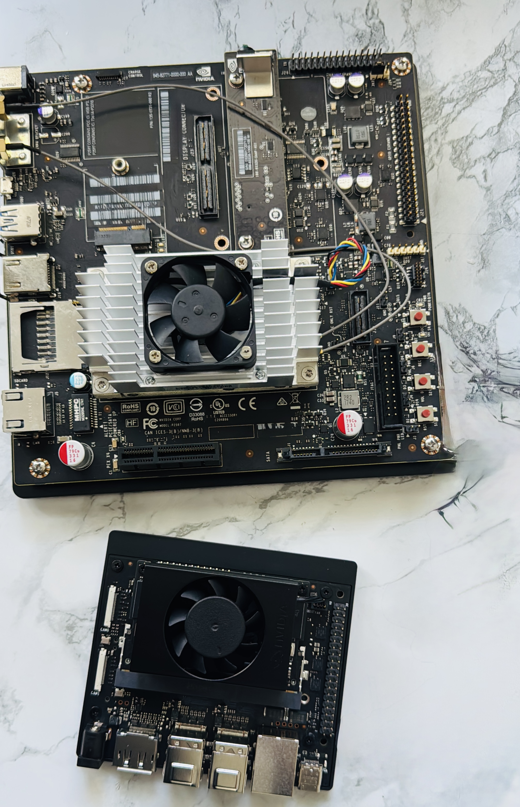

# PracticeParallelProgramming

Memory Access Basics:
Vector Add - grid, block, thread indexing basics.  
Matrix Addition - 2D matrix, row major and column  major.   
Julia set - graphical representation of equation.  
Mandelbrot Fractals - graphical representation.  
Tree Fractal - graphical represention with rendering.  
  
Tiling and coalesing:
Naive Matrix Multiplication - 1 thread per resultant matrix element.  
Tiled Matrix Multiplication - shared memory access.  
Coalescing Matrix Multiplication - choosing indexing of the matrix so that they are coalesced.  
Tiled and Coalesced matrix multiplication.  
Bench marking of all the matrix multiplication.  
  
Control flow and divergence:
Naive Reduction  
Shared Memory Reduction  
Unroll last warp Reduction

Bank Conflict:
Naive Matrix Transpose - reads coalesced, writes strided  
Tiled Matrix Transpose - loads and stores coalesced with shared memory (bank conflicts)  
Tiled and Padded Transpose - fixing banking conflicts  
  
Parallel Patterns:
Convolution 1 D using constant memory  
Convolution 2 D using constant memory  
Prefix sum - reduction but produces partial sums. (divergence and synchronization)    
Histogram computation  
Sparse Matrix computation  
Merge Sort
Graph Search  

Dynamic Parallelism   
   

All the bench marking are done on Jetson TX2 and Nvidia Orin Nano development board.

  

